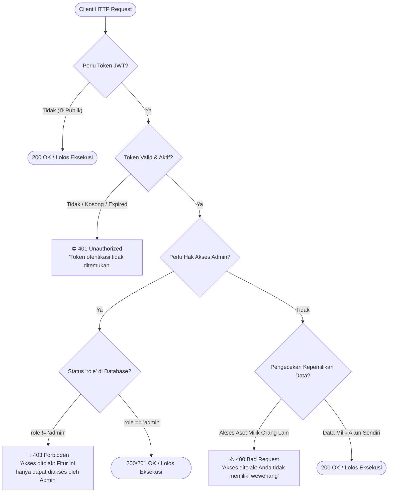

# 🚀 Platform RESTful API E-Commerce - Evermos Mini Project

Layanan RESTful API backend e-commerce yang tangguh dan terukur, dirancang dengan bahasa pemrograman **Golang**, kerangka kerja **Fiber v2**, ORM **GORM**, serta basis data relasional **MySQL**. Proyek ini merupakan implementasi Tugas Akhir program **Virtual Internship Rakamin x Evermos Backend Developer** dengan mengadopsi pola rancang **Clean Architecture**, pengamanan berbasis **JSON Web Token (JWT)**, kendali akses **Role-Based Access Control (RBAC)**, dan jaminan **Isolasi Data Antar-Pengguna**.

---

## 📖 Ringkasan Proyek

Evermos Mini Project menghadirkan fondasi backend untuk ekosistem niaga elektronik (*e-commerce*). Sistem ini mengakomodasi seluruh siklus operasional bisnis: mulai dari pendaftaran akun pembeli, pembentukan toko penjual secara otomatis, pengaturan data profil dan buku alamat, kurasi kategori produk bertingkat, penelusuran katalog produk dengan filter dinamis, hingga pemrosesan transaksi pembelian yang dilengkapi perekaman snapshot produk historis.

Seluruh endpoint dan format respons dirancang agar selaras 100% dengan alur uji otomatis pada **Rakamin Evermos Postman Collection**.

### 💡 Sasaran Desain & Nilai Arsitektur
- **Penerapan Clean Architecture**: Pemisahan tanggung jawab kode yang terisolasi ke dalam 4 lapisan mandiri: *Domain Entities*, *Data Access (Repository)*, *Business Logic (Usecase)*, dan *HTTP Delivery (Controller)*.
- **Sistem Keamanan Berlapis**: Proteksi rute privat melalui otentikasi JWT serta verifikasi hak akses dinamis untuk peran *User* dan *Admin*.
- **Isolasi Sumber Daya (Data Isolation)**: Penjagaan privasi data yang ketat; setiap pengguna hanya diizinkan mengelola data miliknya sendiri tanpa celah memanipulasi data milik pihak lain.
- **Konsistensi Transaksi (ACID) & Snapshot Historis**: Checkout pembelian dijalankan di dalam transaksi basis data terpadu untuk memastikan keakuratan stok dan mengunci spesifikasi produk saat transaksi berlangsung ke dalam tabel log.
- **Pengelolaan Berkas Unggahan**: Penanganan berkas gambar secara *multipart form-data* untuk avatar/logo toko dan galeri foto produk.
- **Integrasi Layanan Geografis Eksternal**: Sinkronisasi data provinsi dan kabupaten/kota secara langsung melalui API publik *emsifa.com*.

---

## 💎 Kapabilitas & Fitur Sistem

### 🔑 1. Akses & Autentikasi Akun
- **Pendaftaran Akun (`POST /auth/register`)**: Registrasi akun pengguna baru dengan proteksi kata sandi menggunakan hashing satu arah **Bcrypt**. Pengecekan ketat diterapkan agar email dan nomor telepon tidak duplikat.
- **Inisialisasi Toko Otomatis**: Ketika pendaftaran akun berhasil disimpan, sistem secara otomatis menerbitkan toko baru yang tertaut langsung dengan ID pengguna terkait.
- **Autentikasi Pengguna (`POST /auth/login`)**: Pemeriksaan kredensial nomor telepon dan kata sandi yang menghasilkan token JWT dengan masa kedaluwarsa 24 jam.
- **Fleksibilitas Pembacaan Token**: Middleware otentikasi dirancang adaptif membaca token melalui header standar `Authorization: Bearer <token>` maupun header khusus pengujian `token: <token>`.

### 👥 2. Manajemen Akun & Buku Alamat
- **Informasi Profil (`GET /user`, `PUT /user`)**: Mengakses rincian data diri lengkap yang telah terelasi dengan toko, daftar alamat, serta riwayat transaksi, beserta fitur pembaruan profil yang tervalidasi.
- **Pengelolaan Alamat Pengiriman (`/user/alamat`)**:
  - `GET /user/alamat`: Mengambil daftar seluruh alamat milik akun yang sedang aktif.
  - `GET /user/alamat/:id`: Menampilkan rincian alamat tertentu.
  - `POST /user/alamat`: Mendaftarkan tujuan pengiriman baru.
  - `PUT /user/alamat/:id`: Memperbarui data alamat pengiriman.
  - `DELETE /user/alamat/:id`: Menghapus data alamat.
- **Validasi Alamat Transaksi**: Pembelian produk mewajibkan penggunaan alamat pengiriman sah yang terdaftar atas nama pemesan.

### 🏬 3. Manajemen Toko & Gerai
- `GET /toko`: Eksplorasi daftar seluruh toko terdaftar dengan dukungan paginasi halaman (`page`, `limit`) dan kata kunci nama (`nama`).
- `GET /toko/my`: Memuat rincian toko milik pengguna yang tengah masuk ke sistem.
- `GET /toko/:id_toko`: Menampilkan profil publik suatu toko berdasarkan ID uniknya.
- `PUT /toko/:id_toko`: Mengubah identitas toko dan mengunggah logo gerai melalui *multipart form-data* (khusus bagi pemilik gerai).

### 🏷️ 4. Tata Kelola Kategori Produk (Hak Akses Admin)
- `GET /category`: Menampilkan katalog kategori produk dengan dukungan filter pencarian dan paginasi (🌐 **Akses Publik**).
- `GET /category/:id`: Memperoleh rincian satu kategori produk berdasarkan ID (🌐 **Akses Publik**).
- `POST /category`: Mendaftarkan nama kategori baru (🛡️ **Eksklusif Administrator**).
- `PUT /category/:id`: Mengubah identitas kategori produk (🛡️ **Eksklusif Administrator**).
- `DELETE /category/:id`: Menghapus kategori produk (🛡️ **Eksklusif Administrator**).
- **Verifikasi Status Admin Dinamis (Tanpa Perlu Login Ulang)**:
  Sistem memeriksa kolom `role` langsung ke basis data pada setiap request. Jika user biasa (`role = 'user'`) mencoba mengakses endpoint create/update/delete kategori, sistem akan menolak dengan status `403 Forbidden`. Untuk memberikan hak akses admin, cukup jalankan query SQL:
  ```sql
  UPDATE users SET role = 'admin' WHERE id = 1;
  ```
  Perubahan ini langsung aktif seketika pada token yang sama tanpa perlu login ulang (*re-login*).

### 📦 5. Manajemen Produk & Inventaris
- `GET /product`: Menampilkan etalase produk publik yang dilengkapi parameter filter lengkap:
  - `nama_produk`: Pencarian nama produk (*case-insensitive*).
  - `category_id`: Penyaringan berdasarkan ID kelompok kategori.
  - `toko_id`: Penyaringan berdasarkan ID gerai toko penjual.
  - `min_harga` & `max_harga`: Pembatasan rentang harga jual konsumen.
  - `page` & `limit`: Kendali nomor halaman dan batas data per respon.
- `GET /product/:id`: Menampilkan spesifikasi menyeluruh produk beserta relasi toko dan kategorinya.
- `POST /product`: Penambahan item barang dagangan baru oleh pemilik toko dengan lampiran foto (mendukung key form-data `photo` maupun `photos`).
- `PUT /product/:id`: Pembaruan deskripsi, harga, persediaan, dan foto produk milik toko yang sah.
- `DELETE /product/:id`: Penghapusan item produk dari etalase toko.

### 🧾 6. Pemrosesan Transaksi & Pencatatan Snapshot
- `POST /trx`: Eksekusi pesanan barang:
  - Validasi kepemilikan alamat pengiriman pemesan.
  - Pengecekan ketersediaan stok fisik di gudang.
  - Pengurangan kuantitas stok produk secara otomatis.
  - Penyalinan kondisi produk ke tabel `log_produks` pada waktu transaksi terjadi (mengunci nama produk, deskripsi, harga beli, kategori, dan identitas toko).
  - Penerbitan kode invoice unik berformat `INV-{user_id}-{timestamp}`.
- `GET /trx`: Menampilkan rekam jejak pesanan milik akun aktif beserta rincian item barang dan relasi snapshot produk.
- `GET /trx/:id`: Menampilkan lembar detail pesanan spesifik.
- `PUT /trx/:id/status`: Pembaruan status pergerakan pesanan (*Menunggu Pembayaran*, *Dikirim*, *Selesai*).

### 🗺️ 7. Integrasi Wilayah Indonesia (emsifa.com)
- `GET /provcity/listprovincies`: Pengambilan daftar seluruh provinsi di wilayah Republik Indonesia.
- `GET /provcity/listcities/:prov_id`: Pengambilan daftar kota/kabupaten di bawah naungan ID provinsi tertentu.
- `GET /provcity/detailprovince/:prov_id`: Menampilkan informasi spesifik satu provinsi.
- `GET /provcity/detailcity/:city_id`: Menampilkan informasi spesifik satu kota/kabupaten.

---

## 🏛️ Desain Arsitektur Kode (Clean Architecture)

Aplikasi dibangun dengan memisahkan domain masalah menjadi lapisan-lapisan yang terisolasi dengan rapi:

```
FinalTaskBackendRakamin/
├── config/                      # Inisialisasi basis data & pengisian data awal (seeder)
│   ├── database.go              # Konfigurasi koneksi MySQL & manajemen connection pool
│   └── seeder.go                # Seeder kategori awal (Fashion, Aksesoris, Rumah Tangga)
├── controllers/                 # Delivery Layer (Penerima Request & Pengirim Respons HTTP Fiber)
│   ├── alamat_controller.go     # Pengendali endpoint alamat pengiriman
│   ├── auth_controller.go       # Pengendali endpoint registrasi & otentikasi login
│   ├── category_controller.go   # Pengendali endpoint kategori produk
│   ├── product_controller.go    # Pengendali endpoint katalog & unggah gambar produk
│   ├── provcity_controller.go   # Pengendali endpoint data wilayah eksternal emsifa
│   ├── toko_controller.go       # Pengendali endpoint toko & unggah logo
│   ├── trx_controller.go        # Pengendali endpoint transaksi belanja
│   └── user_controller.go       # Pengendali endpoint profil pengguna
├── middleware/                  # Lapisan Filter & Proteksi HTTP
│   ├── admin_middleware.go      # Validasi hak akses Admin langsung dari basis data
│   └── jwt_middleware.go        # Otentikasi token JWT & injeksi konteks pengguna
├── models/                      # Domain Entities (Struktur Data & Relasi Relasional GORM)
│   ├── alamat.go                # Struktur entitas alamat
│   ├── category.go              # Struktur entitas kategori
│   ├── detail_transaksi.go      # Struktur entitas item belanja
│   ├── log_produk.go            # Struktur entitas snapshot produk saat transaksi
│   ├── produk.go                # Struktur entitas produk etalase
│   ├── toko.go                  # Struktur entitas gerai toko
│   ├── transaksi.go             # Struktur entitas nota transaksi
│   └── user.go                  # Struktur entitas pengguna
├── repositories/                # Data Access Layer (Abstraksi Query & Manipulasi Data GORM)
│   ├── alamat_repository.go
│   ├── category_repository.go
│   ├── product_repository.go
│   ├── toko_repository.go
│   ├── trx_repository.go
│   └── user_repository.go
├── routes/                      # Route Registration
│   └── routes.go                # Registrasi seluruh jalur endpoint HTTP
├── uploads/                     # Direktori penyimpanan berkas hasil unggahan pengguna
├── usecases/                    # Business Logic Layer (Aturan Bisnis & Rekayasa Logika)
│   ├── alamat_usecase.go        # Logika isolasi & manipulasi alamat
│   ├── auth_usecase.go          # Logika enkripsi, auto-create toko, & penerbitan token
│   ├── category_usecase.go      # Logika pemrosesan kategori
│   ├── product_usecase.go       # Logika inventaris, filter pencarian, & relasi toko
│   ├── provcity_usecase.go      # Logika pemanggilan HTTP client layanan wilayah
│   ├── toko_usecase.go          # Logika kepemilikan gerai toko
│   ├── trx_usecase.go           # Logika transaksi atomik, validasi stok, & snapshot log
│   └── user_usecase.go          # Logika profil & pencegahan duplikasi data unik
├── utils/                       # Utilitas Pendukung
│   ├── hash_utils.go            # Fungsi hashing & verifikasi Bcrypt
│   ├── jwt_utils.go             # Pembuatan klaim & parsing verifikasi JWT
│   └── response_utils.go        # Format respons JSON standar & kalkulasi paginasi
├── .env                         # Konfigurasi variabel lingkungan aktif
├── .env.example                 # Contoh templat variabel lingkungan
├── .gitignore
├── go.mod                       # Definisi modul dependensi Golang
├── go.sum                       # Checksum integritas paket modul
├── main.go                      # Titik awal eksekusi aplikasi (*entry point*)
└── Rakamin Evermos Virtual Internship.postman_collection.json # Berkas uji Postman resmi
```

---

## 🛠️ Petunjuk Instalasi & Menjalankan Aplikasi

### 📑 Syarat Awal Sistem
Pastikan lingkungan pengembangan Anda telah dilengkapi:
- **Golang** versi 1.22 atau yang lebih baru ([Unduh Go](https://go.dev/dl/))
- **MySQL** versi 8.0 atau varian MariaDB ([Unduh MySQL](https://dev.mysql.com/downloads/))
- **Postman** untuk pelaksanaan uji coba API ([Unduh Postman](https://www.postman.com/downloads/))

---

### Langkah 1: Persiapan Basis Data MySQL
Jalankan server MySQL Anda (dapat menggunakan Laragon, XAMPP, atau service native), kemudian buat skema basis data baru:
```sql
CREATE DATABASE IF NOT EXISTS evermos_mini;
```

---

### Langkah 2: Konfigurasi Berkas `.env`
Salin template berkas `.env.example` ke `.env` pada direktori utama proyek, lalu sesuaikan parameter kredensial Anda:
```env
# Konfigurasi Koneksi MySQL
DB_USER=root
DB_PASS=
DB_HOST=127.0.0.1
DB_PORT=3306
DB_NAME=evermos_mini

# Port Komunikasi Server
APP_PORT=:8080

# Kunci Rahasia Tanda Tangan JWT
JWT_SECRET=supersecretkey_evermos_rakamin_2025
```

---

### Langkah 3: Unduh Dependensi & Menjalankan Server
Eksekusi instruksi berikut pada terminal di folder proyek:
```bash
# Sinkronisasi pustaka dependensi
go mod tidy

# Menjalankan server aplikasi
go run main.go
```

Setelah server aktif, baris informasi berikut akan tercetak pada terminal:
```text
Koneksi database MySQL berhasil tersambung.
Migrasi tabel database berhasil selesai.
Seeder kategori awal berhasil dieksekusi.
Aplikasi berjalan di http://localhost:8080
```

---

## 🔬 Prosedur Pengujian Menggunakan Postman

### 📥 1. Impor Berkas Koleksi
1. Buka aplikasi **Postman**.
2. Klik tombol **Import** pada bilah navigasi kiri atas.
3. Arahkan dan pilih file `Rakamin Evermos Virtual Internship.postman_collection.json` dari folder proyek.
4. Koleksi uji coba siap digunakan pada panel navigasi.

### 🔌 2. Pengaturan Variabel Lingkungan (Environment)
1. Buat environment baru di Postman dengan nama `Evermos Local`.
2. Tentukan variabel berikut:
   | Variable | Initial Value | Current Value |
   | :--- | :--- | :--- |
   | `local` | `http://localhost:8080` | `http://localhost:8080` |
   | `token` | *(dikosongkan)* | *(terisi secara otomatis saat Login)* |
3. Pastikan environment `Evermos Local` telah diaktifkan pada pojok kanan atas jendela Postman.

### 📑 3. Urutan Skenario Pengujian yang Disarankan
Untuk menjamin kesinambungan alur relasi data:
1. **Auth > Register (`POST /auth/register`)**: Membuat akun pemakai baru. Gerai toko langsung terbit otomatis.
2. **Auth > Login (`POST /auth/login`)**: Melakukan otentikasi. Token otorisasi otomatis tersimpan ke variabel lingkungan `{{token}}`.
3. **User > Get My Profile (`GET /user`)**: Menguji respons rute terproteksi dan memeriksa data toko yang telah terikat.
4. **User > Alamat Kirim > Post Alamat (`POST /user/alamat`)**: Mendaftarkan alamat tujuan barang untuk keperluan transaksi.
5. **Toko > Update Profile Toko (`PUT /toko/:id_toko`)**: Menguji pengunggahan gambar logo toko melalui tipe *form-data* (key: `photo`).
6. **Product > Post Product (`POST /product`)**: Mendaftarkan barang dagangan baru beserta lampiran berkas gambar produk (key: `photo` atau `photos`).
7. **Product > Get All Product (`GET /product`)**: Menjalankan pengujian filter rentang harga, nama barang, kategori, serta navigasi paginasi.
8. **Trx > Post Trx (`POST /trx`)**: Melakukan pemesanan barang. Sistem memotong sisa persediaan dan merekam snapshot kondisi produk ke tabel log.
9. **Trx > Get All Trx (`GET /trx`)**: Menampilkan daftar rekap transaksi pemesan beserta item log snapshot produk.
10. **Category (Pengujian Hak Akses Admin vs User Biasa)**:
    - **Uji Penolakan (User Biasa)**: Jalankan permintaan **Post Category (`POST /category`)** menggunakan token akun biasa. Sistem otomatis menolak dengan respon status `403 Forbidden` (*"Akses ditolak: Fitur ini hanya dapat diakses oleh Admin"*).
    - **Promosikan Akun ke Admin**: Buka terminal MySQL dan perbarui peran user menjadi admin:
      ```sql
      UPDATE users SET role = 'admin' WHERE id = 1;
      ```
    - **Uji Keberhasilan (Admin)**: Jalankan kembali permintaan **Post Category**, **Update Category By ID**, dan **Delete Category By ID** menggunakan token yang sama. Seluruh permintaan langsung sukses (`201 Created` / `200 OK`) tanpa perlu *re-login* berkat verifikasi dinamis ke basis data.
11. **Province City**: Jalankan seluruh endpoint pada folder `Province City` untuk memeriksa integrasi data geografis Indonesia dari layanan `emsifa.com`.

---

## 🔐 Panduan & Sistem Hak Akses (RBAC & Data Ownership)

Sistem mengadopsi model keamanan **3 Lapis (Defense-in-Depth)** yang memadukan **Otentikasi Token JWT**, **Role-Based Access Control (RBAC)** dinamis, dan **Resource Ownership (Isolasi Data Antar-Pengguna)**. Model ini memastikan setiap pengguna hanya dapat menjalankan operasi sesuai wewenang dan kepemilikan asetnya.

---

### 👥 1. Empat Tingkatan Hak Akses (Role & Privilege Levels)

| Badge | Tingkat Hak Akses | Syarat & Header | Siapa Penggunanya? | Cakupan Hak Akses (Apa yang Boleh Dilakukan?) |
| :---: | :--- | :--- | :--- | :--- |
| 🌐 | **Publik (Tamu)** | Tanpa Token | Pengunjung umum / klien belum login | • Melihat etalase katalog & detail produk (`GET /product`)<br>• Melihat direktori toko terdaftar (`GET /toko`)<br>• Melihat katalog kelompok kategori (`GET /category`)<br>• Melihat data wilayah Indonesia (`GET /provcity/*`)<br>• Mendaftarkan akun baru & melakukan login (`POST /auth/*`) |
| 👤 | **User (JWT)** | Header `Authorization: Bearer <token>` atau `token: <token>` | Seluruh pengguna terdaftar yang sudah login (`role = 'user'`) | • Melihat & memperbarui data profil akun sendiri (`/user`)<br>• Menambah & mengelola buku alamat pribadi (`/user/alamat`)<br>• Melihat rincian toko milik sendiri (`GET /toko/my`)<br>• Menambah produk baru ke toko sendiri (`POST /product`)<br>• Melakukan checkout belanjaan (`POST /trx`)<br>• Melihat rekap transaksi pesanan sendiri (`GET /trx`) |
| 🏪 | **Pemilik Toko** | Token JWT + Kepemilikan Sah (`user_id` / `toko_id`) | Akun login yang merupakan pemilik sah toko / barang dagangan | • Mengubah nama & logo tokonya sendiri (`PUT /toko/:id_toko`)<br>• Mengubah harga, persediaan, & foto produk miliknya (`PUT /product/:id`)<br>• Menghapus produk dari etalase toko miliknya (`DELETE /product/:id`)<br>⚠️ *Sistem menolak modifikasi jika aset tersebut milik toko user lain.* |
| 🛡️ | **Admin Only** | Token JWT + Status `role = 'admin'` di database | Administrator / Pengelola Platform | • Menambahkan master kategori baru (`POST /category`)<br>• Mengubah nama kelompok kategori (`PUT /category/:id`)<br>• Menghapus data kelompok kategori (`DELETE /category/:id`)<br>• Memiliki seluruh kapabilitas operasional pengguna standar |

---

### 📊 2. Matriks Hak Akses Seluruh Endpoint (Access Control Matrix)

Gunakan matriks ringkas berikut untuk memahami wewenang setiap peran pada setiap endpoint API:

| Modul | Endpoint | Method | 🌐 Publik | 👤 User | 🏪 Pemilik | 🛡️ Admin | Proteksi & Aturan Hak Akses |
| :--- | :--- | :---: | :---: | :---: | :---: | :---: | :--- |
| **Auth** | `/auth/register` | `POST` | ✅ | ❌ | ❌ | ❌ | Registrasi publik; otomatis membuat toko baru |
| | `/auth/login` | `POST` | ✅ | ❌ | ❌ | ❌ | Otentikasi nomor telepon & password -> terbit JWT |
| **User** | `/user` | `GET`, `PUT` | ❌ | ✅ | ✅ | ✅ | **Terisolasi**: Hanya data profil milik akun yang login |
| **Alamat** | `/user/alamat` | `GET`, `POST` | ❌ | ✅ | ✅ | ✅ | **Terisolasi**: Buku alamat pribadi milik akun login |
| | `/user/alamat/:id` | `GET`, `PUT`, `DELETE` | ❌ | ✅ | ✅ | ✅ | **Terisolasi**: Query dibatasi `id = ? AND user_id = ?` |
| **Toko** | `/toko`, `/toko/:id_toko` | `GET` | ✅ | ✅ | ✅ | ✅ | Katalog etalase toko dapat diakses publik |
| | `/toko/my` | `GET` | ❌ | ✅ | ✅ | ✅ | Khusus melihat toko milik pengguna yang login |
| | `/toko/:id_toko` | `PUT` | ❌ | ❌ | ✅ | ❌ | **Hanya Pemilik Toko Sah** (`toko.user_id = user_id`) |
| **Kategori** | `/category`, `/category/:id` | `GET` | ✅ | ✅ | ✅ | ✅ | Katalog kategori produk terbuka bebas untuk umum |
| | `/category` | `POST` | ❌ | ❌ | ❌ | ✅ | **Khusus Admin**: User biasa menerima respon `403 Forbidden` |
| | `/category/:id` | `PUT`, `DELETE` | ❌ | ❌ | ❌ | ✅ | **Khusus Admin**: User biasa menerima respon `403 Forbidden` |
| **Produk** | `/product`, `/product/:id` | `GET` | ✅ | ✅ | ✅ | ✅ | Katalog etalase publik (filter nama, harga, kategori, toko) |
| | `/product` | `POST` | ❌ | ✅ | ✅ | ✅ | Menerbitkan produk baru ke dalam toko milik akun login |
| | `/product/:id` | `PUT`, `DELETE` | ❌ | ❌ | ✅ | ❌ | **Hanya Pemilik Produk Sah** (`produk.toko_id = user_toko_id`) |
| **Transaksi**| `/trx`, `/trx/:id` | `GET` | ❌ | ✅ | ✅ | ✅ | **Terisolasi**: Riwayat pesanan milik akun yang login |
| | `/trx` | `POST` | ❌ | ✅ | ✅ | ✅ | Checkout pesanan (alamat wajib milik akun login) |
| | `/trx/:id/status` | `PUT` | ❌ | ✅ | ✅ | ✅ | Pembaruan status pemesanan barang |
| **Wilayah** | `/provcity/*` | `GET` | ✅ | ✅ | ✅ | ✅ | Data referensi wilayah publik Indonesia (emsifa.com) |

---

### 🛡️ 3. Arsitektur Verifikasi 3 Lapis (Three-Tier Security Enforcement)

Setiap request HTTP yang masuk ke backend disaring melalui tiga tahapan keamanan secara berurutan:



#### 🔹 Lapis 1: Otentikasi Pengguna (JWT Middleware)
- **File Implementasi**: [jwt_middleware.go](file:///c:/Users/ANG-PC/Downloads/FinalTaskBackendRakamin/middleware/jwt_middleware.go)
- **Cara Kerja**: Membaca token dari header standar `Authorization: Bearer <token>` maupun header pengujian `token: <token>`. Jika token tidak ada, tidak valid, atau telah melampaui masa aktif 24 jam, server langsung menghentikan request.
- **Contoh Respon Penolakan (HTTP 401 Unauthorized)**:
  ```json
  {
    "status": false,
    "message": "Token otentikasi tidak ditemukan"
  }
  ```

#### 🔹 Lapis 2: Otorisasi Peran Admin Dinamis (Admin Middleware)
- **File Implementasi**: [admin_middleware.go](file:///c:/Users/ANG-PC/Downloads/FinalTaskBackendRakamin/middleware/admin_middleware.go)
- **Cara Kerja**: Khusus untuk endpoint `/category` (`POST`, `PUT`, `DELETE`), middleware memeriksa langsung kolom `role` pengguna ke tabel basis data:
  ```sql
  SELECT id, role FROM users WHERE id = ?;
  ```
- **Kelebihan Pendekatan Dinamis**: Sistem **tidak bergantung** pada klaim statis di dalam payload JWT. Jika seorang pengguna dinaikkan perannya menjadi `admin` melalui query SQL di database, hak akses langsung aktif seketika pada token yang sedang dipakai **tanpa perlu login ulang / membuat token baru**.
- **Contoh Respon Penolakan (HTTP 403 Forbidden)**:
  ```json
  {
    "status": false,
    "message": "Akses ditolak: Fitur ini hanya dapat diakses oleh Admin"
  }
  ```

#### 🔹 Lapis 3: Kontrol Kepemilikan & Isolasi Data (Data Ownership / Resource Isolation)
- **File Implementasi**: [toko_usecase.go](file:///c:/Users/ANG-PC/Downloads/FinalTaskBackendRakamin/usecases/toko_usecase.go), [product_usecase.go](file:///c:/Users/ANG-PC/Downloads/FinalTaskBackendRakamin/usecases/product_usecase.go), [alamat_usecase.go](file:///c:/Users/ANG-PC/Downloads/FinalTaskBackendRakamin/usecases/alamat_usecase.go), [trx_usecase.go](file:///c:/Users/ANG-PC/Downloads/FinalTaskBackendRakamin/usecases/trx_usecase.go)
- **Cara Kerja**: Pengguna yang sah (ber-token) tetap tidak boleh mengakses atau mengubah data milik pengguna lain:
  - **Toko**: Mengubah profil toko diverifikasi dengan `toko.UserID == userID`. Jika berbeda -> Ditolak.
  - **Produk**: Memperbarui/menghapus produk diverifikasi dengan `product.TokoID == userToko.ID`. Jika user mencoba mengedit produk dari toko orang lain -> Ditolak.
  - **Alamat Kirim**: Setiap query alamat selalu dikunci ganda `WHERE id = ? AND user_id = ?`.
  - **Transaksi Belanja**: Checkout transaksi memeriksa kepemilikan alamat kirim (`FindByIDAndUserID`). Riwayat transaksi hanya menampilkan data nota pesanan milik user pembuat transaksi.
- **Contoh Respon Penolakan (HTTP 400 Bad Request)**:
  ```json
  {
    "status": false,
    "message": "akses ditolak: Anda tidak memiliki wewenang untuk mengubah toko ini"
  }
  ```

---

## 📑 Spesifikasi Endpoint API Lengkap

> 💡 **Legenda Badge Hak Akses:**
> - 🌐 **Publik**: Dapat diakses bebas oleh siapa saja tanpa autentikasi / token.
> - 👤 **User (JWT)**: Wajib melampirkan Token JWT aktif (`Authorization: Bearer <token>` atau `token: <token>`).
> - 🏪 **Pemilik Toko**: Wajib Token JWT & hanya pemilik sah atas toko / produk terkait (Proteksi Isolasi Data).
> - 🛡️ **Admin Only**: Wajib Token JWT dari akun yang memiliki kolom `role = 'admin'` di database.

### 🔑 1. Autentikasi Pengguna (`/auth`)
| Method | Rute Endpoint | Penjelasan Fungsi | Hak Akses |
| :---: | :--- | :--- | :---: |
| `POST` | `/auth/register` | Mendaftarkan akun pemakai baru (sekaligus mendirikan gerai toko) | 🌐 Publik |
| `POST` | `/auth/login` | Memvalidasi kredensial pengguna dan menerbitkan JWT token | 🌐 Publik |

**Format Payload Pendaftaran Akun (`POST /auth/register`):**
```json
{
  "nama": "Andi Pratama",
  "email": "andi@example.com",
  "no_telp": "081234567890",
  "kata_sandi": "password123",
  "tanggal_Lahir": "1998-05-20",
  "jenis_kelamin": "Laki-laki",
  "pekerjaan": "Karyawan Swasta",
  "id_provinsi": "32",
  "id_kota": "3273"
}
```

**Format Payload Masuk Akun (`POST /auth/login`):**
```json
{
  "no_telp": "081234567890",
  "kata_sandi": "password123"
}
```

---

### 👤 2. Profil Pengguna (`/user`)
| Method | Rute Endpoint | Penjelasan Fungsi | Hak Akses |
| :---: | :--- | :--- | :---: |
| `GET` | `/user` | Memuat profil lengkap pengguna aktif beserta data toko, alamat, dan transaksi | 👤 User (JWT) |
| `PUT` | `/user` | Memperbarui informasi biodata profil akun aktif | 👤 User (JWT) |

---

### 📍 3. Alamat Pengiriman Pengguna (`/user/alamat`)
| Method | Rute Endpoint | Penjelasan Fungsi | Hak Akses |
| :---: | :--- | :--- | :---: |
| `GET` | `/user/alamat` | Menampilkan seluruh koleksi alamat milik pengguna aktif | 👤 User (JWT) |
| `GET` | `/user/alamat/:id` | Menampilkan lembar rincian satu alamat tertentu | 👤 User (JWT) |
| `POST` | `/user/alamat` | Menyimpan entri alamat kirim baru | 👤 User (JWT) |
| `PUT` | `/user/alamat/:id` | Mengubah rincian data alamat yang terdaftar | 👤 User (JWT) |
| `DELETE` | `/user/alamat/:id` | Menghapus entri alamat kirim | 👤 User (JWT) |

**Format Payload Alamat (`POST /user/alamat`):**
```json
{
  "judul_alamat": "Kantor Pusat",
  "nama_penerima": "Andi Pratama",
  "no_telp": "081234567890",
  "provinsi": "Jawa Barat",
  "kota": "Kota Bandung",
  "kecamatan": "Coblong",
  "kelurahan": "Dago",
  "detail_alamat": "Jl. Ganesha No. 10"
}
```

---

### 🏬 4. Manajemen Gerai Toko (`/toko`)
| Method | Rute Endpoint | Penjelasan Fungsi | Hak Akses |
| :---: | :--- | :--- | :---: |
| `GET` | `/toko` | Menampilkan etalase toko terdaftar (dukungan paginasi & filter nama gerai) | 🌐 Publik |
| `GET` | `/toko/my` | Mengambil data toko yang dimiliki oleh pengguna aktif | 👤 User (JWT) |
| `GET` | `/toko/:id_toko` | Menampilkan rincian gerai berdasarkan ID toko | 🌐 Publik |
| `PUT` | `/toko/:id_toko` | Memperbarui nama dan berkas logo gerai toko (`multipart/form-data`) | 🏪 Pemilik Toko |

> **Panduan Berkas Toko:** Kirimkan request bertipe `multipart/form-data` dengan field `nama_toko` (teks) dan `photo` (file gambar).

---

### 🏷️ 5. Tata Kelola Kategori Barang (`/category`)
| Method | Rute Endpoint | Penjelasan Fungsi | Hak Akses |
| :---: | :--- | :--- | :---: |
| `GET` | `/category` | Menampilkan seluruh kategori produk dengan paginasi & pencarian | 🌐 Publik |
| `GET` | `/category/:id` | Menampilkan rincian informasi kategori berdasarkan ID | 🌐 Publik |
| `POST` | `/category` | Menambahkan kelompok kategori baru | 🛡️ Admin Only |
| `PUT` | `/category/:id` | Memperbarui nama kelompok kategori | 🛡️ Admin Only |
| `DELETE` | `/category/:id` | Menghapus kelompok kategori | 🛡️ Admin Only |

---

### 📦 6. Etalase Produk Dagangan (`/product`)
| Method | Rute Endpoint | Penjelasan Fungsi | Hak Akses |
| :---: | :--- | :--- | :---: |
| `GET` | `/product` | Menampilkan katalog produk publik dengan filter parameter komprehensif | 🌐 Publik |
| `GET` | `/product/:id` | Menampilkan spesifikasi rincian barang berdasarkan ID produk | 🌐 Publik |
| `POST` | `/product` | Menerbitkan produk dagangan baru di toko pengguna login | 👤 User (JWT) |
| `PUT` | `/product/:id` | Memperbarui spesifikasi & gambar barang milik toko pengguna | 🏪 Pemilik Toko |
| `DELETE` | `/product/:id` | Menghapus produk dagangan dari katalog toko | 🏪 Pemilik Toko |

**Daftar Parameter URL pada `GET /product`:**
- `page` (default: 1): Nomor halaman paginasi.
- `limit` (default: 10): Kapasitas record data per lembar respons.
- `nama_produk`: Pencarian berdasarkan kecocokan nama produk.
- `category_id`: Filter produk sesuai ID kategori.
- `toko_id`: Filter produk berdasarkan ID toko penjual.
- `min_harga` & `max_harga`: Filter batasan rentang harga konsumen.

**Contoh Format Form-Data `POST /product`:**
- `nama_produk`: Kemeja Pria Formal
- `category_id`: 1
- `harga_reseller`: 95000
- `harga_konsumen`: 120000
- `stok`: 100
- `deskripsi`: Kemeja lengan panjang bahan katun premium.
- `photos` / `photo`: *(file berkas gambar .jpg/.png)*

---

### 🧾 7. Pemrosesan Transaksi Belanja (`/trx`)
| Method | Rute Endpoint | Penjelasan Fungsi | Hak Akses |
| :---: | :--- | :--- | :---: |
| `GET` | `/trx` | Menampilkan rekapitulasi riwayat pesanan milik akun aktif | 👤 User (JWT) |
| `GET` | `/trx/:id` | Menampilkan lembar detail nota pesanan spesifik | 👤 User (JWT) |
| `POST` | `/trx` | Melakukan checkout pesanan barang belanjaan | 👤 User (JWT) |
| `PUT` | `/trx/:id/status` | Memperbarui tahapan status pemesanan | 👤 User (JWT) |

**Format Payload Pembelian (`POST /trx`):**
```json
{
  "method_bayar": "bca",
  "alamat_kirim": 1,
  "detail_trx": [
    {
      "product_id": 1,
      "kuantitas": 2
    }
  ]
}
```

---

### 🗺️ 8. Wilayah Administratif Indonesia (`/provcity`)
| Method | Rute Endpoint | Penjelasan Fungsi | Hak Akses |
| :---: | :--- | :--- | :---: |
| `GET` | `/provcity/listprovincies` | Mengambil seluruh daftar provinsi se-Indonesia | 🌐 Publik |
| `GET` | `/provcity/listcities/:prov_id` | Mengambil rincian kota/kabupaten di dalam suatu provinsi | 🌐 Publik |
| `GET` | `/provcity/detailprovince/:prov_id` | Menampilkan informasi detail spesifik suatu provinsi | 🌐 Publik |
| `GET` | `/provcity/detailcity/:city_id` | Menampilkan informasi detail spesifik suatu kota/kabupaten | 🌐 Publik |

---

## 🛡️ Mekanisme Keamanan & Integritas Data

Sistem backend ini mengimplementasikan prinsip *defense-in-depth* dengan tiga garis pertahanan utama:

1. **Otentikasi Token JWT**:
   Seluruh endpoint privat dilindungi oleh middleware [jwt_middleware.go](file:///c:/Users/ANG-PC/Downloads/FinalTaskBackendRakamin/middleware/jwt_middleware.go). Sistem menerima header otentikasi standar `Authorization: Bearer <token>` maupun header `token: <token>` demi kepraktisan pengujian otomasi Postman. Jika token tidak ditemukan, tidak valid, atau telah kadaluarsa, sistem mengembalikan status `HTTP 401 Unauthorized`.
2. **Validasi Otorisasi Administrator Dinamis**:
   Pemeriksaan hak akses Admin pada [admin_middleware.go](file:///c:/Users/ANG-PC/Downloads/FinalTaskBackendRakamin/middleware/admin_middleware.go) membaca langsung baris status `role` pengguna di basis data secara berkala per-request (`SELECT id, role FROM users WHERE id = ?`). Dengan arsitektur ini, perubahan hak akses langsung dari basis data dapat aktif seketika tanpa perlu proses *re-login*. Pengguna non-admin yang memanggil endpoint master kategori akan menerima penolakan `HTTP 403 Forbidden`.
3. **Isolasi Data Komprehensif (Data Ownership & Resource Isolation)**:
   - Pengguna dilarang melihat maupun menyunting informasi profil akun milik orang lain (`/user`).
   - Entri buku alamat dilindungi filter relasi ganda (`id = ? AND user_id = ?`).
   - Penjualan barang dagangan dikunci ketat; pengguna hanya dapat menyunting dan menghapus produk yang terhubung dengan toko miliknya sendiri (`toko_id = user_toko_id`).
   - Riwayat transaksi belanja terisolasi sepenuhnya berdasarkan identitas pengguna pembuat pesanan (`WHERE id = ? AND user_id = ?`).
   - Pelanggaran terhadap isolasi data ditolak dengan status respons `HTTP 400 Bad Request` berserta pesan informatif.

---

## ⚙️ Pendalaman Teknis & Integritas Bisnis

### 📦 Perekaman Snapshot Log Produk Transaksi
Ketika pesanan baru dieksekusi melalui `POST /trx`:
- Sistem menyalin representasi data produk ke dalam tabel `log_produks` secara atomik (merekam spesifikasi nama barang, deskripsi, harga beli, kategori, dan identitas toko saat kesepakatan transaksi terjadi).
- Rincian pesanan pada tabel `detail_transaksis` ditautkan ke kolom `log_produk_id`.
- **Manfaat**: Jika produk asal mengalami kenaikan harga, perubahan deskripsi, atau bahkan dihapus oleh pemilik toko di masa depan, lembar pertanggungjawaban transaksi historis tetap utuh dan akurat.

### 🔄 Pemotongan Stok Konsisten (Transaksi Basis Data)
- Alur pemesanan barang dibungkus dalam mekanisme `db.Transaction(func(tx *gorm.DB) error { ... })`.
- Pemeriksaan jumlah persediaan dilakukan sebelum penyimpanan pesanan.
- Persediaan produk dipotong secara konsisten. Apabila terjadi kegagalan (misalnya persediaan tidak mencukupi atau alamat tidak valid), seluruh tahapan proses akan dibatalkan (*rollback*) secara otomatis.

### 📂 Penyimpanan Berkas Unggahan
- Berkas fisik disimpan langsung ke dalam direktori lokal `./uploads/`.
- Basis data hanya menyimpan referensi alamat URL berkas.
- Server Fiber mengaktifkan static handler: `app.Static("/uploads", "./uploads")` sehingga berkas dapat diakses secara instan oleh peramban maupun aplikasi antarmuka.

---

## 💻 Komponen & Pustaka Teknologi

| Komponen | Pustaka / Teknologi | Peran & Kegunaan |
| :--- | :--- | :--- |
| **Bahasa Pemrograman** | Golang (v1.22+) | Pemrosesan backend dengan konkurensi efisien dan konsumsi memori rendah |
| **HTTP Framework** | Fiber v2 (`gofiber/fiber/v2`) | Kerangka kerja HTTP berbasis Fasthttp dengan performa tinggi |
| **ORM Framework** | GORM (`gorm.io/gorm`) | Pemetaan objek relasional, relasi antar-entitas, dan migrasi otomatis |
| **Driver Basis Data** | GORM MySQL Driver | Driver penghubung resmi ke server MySQL |
| **Sistem Basis Data** | MySQL (v8.0+) | Basis data relasional dengan kepatuhan transaksi ACID |
| **Keamanan Token** | Golang JWT v5 (`golang-jwt/jwt/v5`) | Penandatanganan dan verifikasi klaim identitas berbasis JSON Web Token |
| **Enkripsi Sandi** | Bcrypt (`golang.org/x/crypto/bcrypt`) | Hashing kata sandi searah yang aman dan teruji |
| **Manajemen Konfigurasi** | Godotenv (`joho/godotenv`) | Pembacaan konfigurasi environment berkas `.env` |

---

## 📈 Strategi Efisiensi & Performa Basis Data

- **Connection Pool Optimization**: Dikonfigurasi terpusat pada `config/database.go` (`SetMaxIdleConns`, `SetMaxOpenConns`, dan `SetConnMaxLifetime`) guna menjamin konektivitas tetap stabil di bawah beban konkurensi tinggi.
- **Pemberian Indeks Relasional**: Pengindeksan diterapkan pada kolom relasi kunci luar dan kolom kueri frekuensi tinggi (`email`, `no_telp`, `category_id`, `toko_id`, `user_id`, dan `invoice`).
- **Selective Preload**: Pemuatan relasi GORM dilakukan secara terarah dan terukur guna mengeliminasi potensi anomali performa N+1 query.
- **Paginasi Efisien**: Mengimplementasikan pembatasan `LIMIT` dan `OFFSET` terstandar pada modul etalase dan gerai untuk menjaga latensi tetap rendah pada skala data besar.

---

## 📚 Sumber Rujukan & Dokumentasi Terkait
- [Dokumentasi Bahasa Pemrograman Go](https://go.dev/doc/)
- [Dokumentasi Resmi Framework Fiber](https://docs.gofiber.io/)
- [Panduan Pemakaian GORM ORM](https://gorm.io/docs/)
- [Layanan API Wilayah Indonesia (emsifa.com)](https://www.emsifa.com/api-wilayah-indonesia/)
- [Panduan Konfigurasi MySQL GORM](https://levelup.gitconnected.com/build-a-rest-api-using-go-mysql-gorm-and-mux-a02e9a2865ee)

---

## 🎖️ Catatan Lisensi & Apresiasi

Proyek ini dibangun sebagai penyelesaian tugas akhir program **Virtual Internship Rakamin x Evermos Backend Developer**.

Terima kasih kepada:
- **Rakamin Academy** atas penyediaan silabus dan program pelatihan backend developer yang komprehensif.
- **Evermos** atas studi kasus industri dan tantangan teknis e-commerce yang relevan.
- Para mentor, fasilitator, dan rekan pembelajar atas dukungan serta diskusinya sepanjang program.
